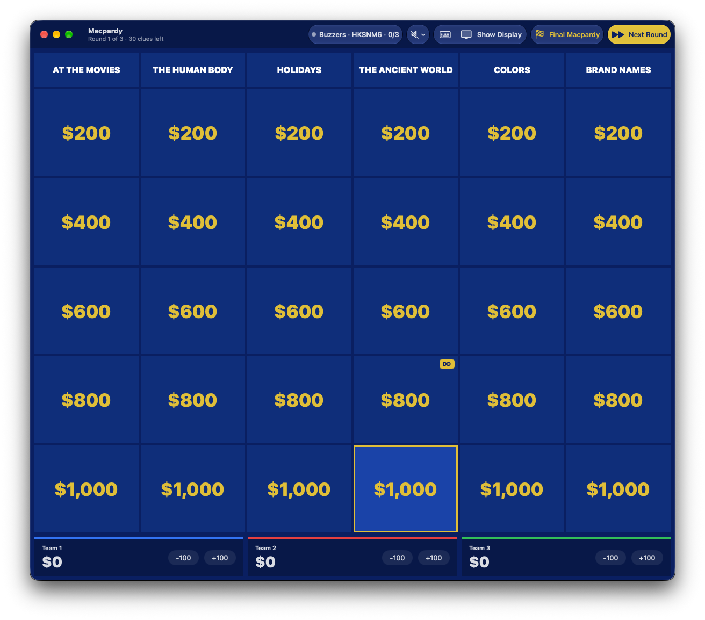
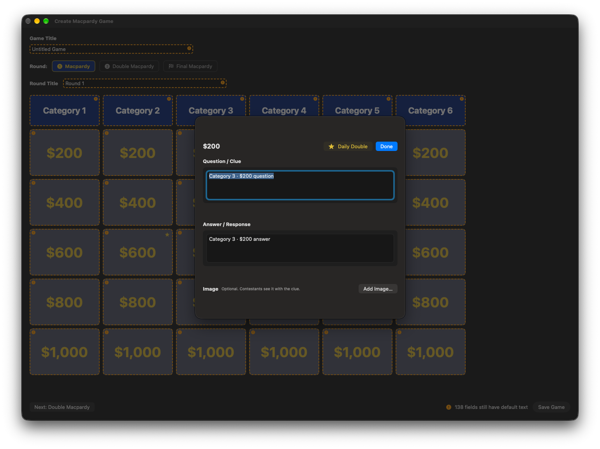
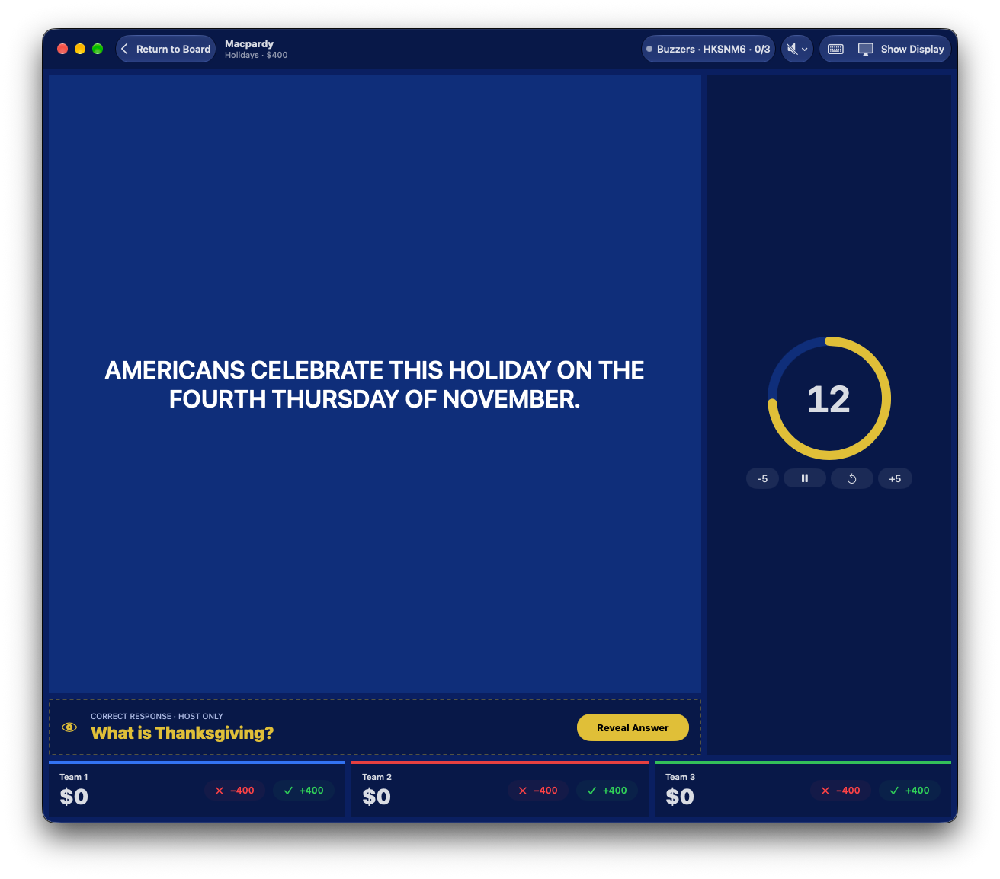
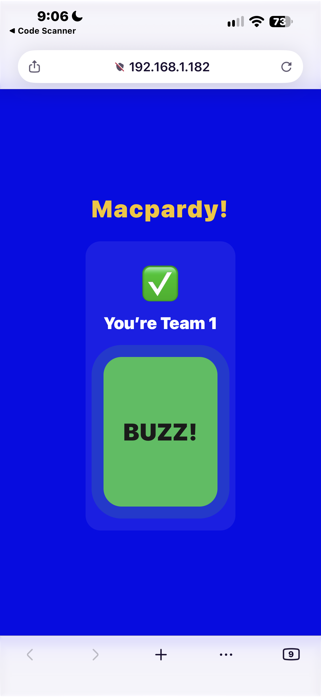
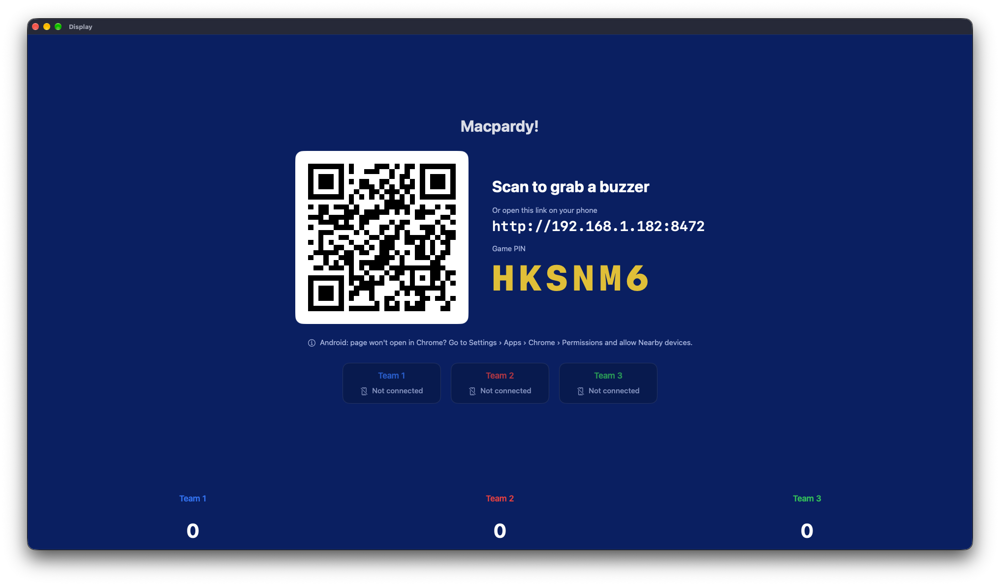
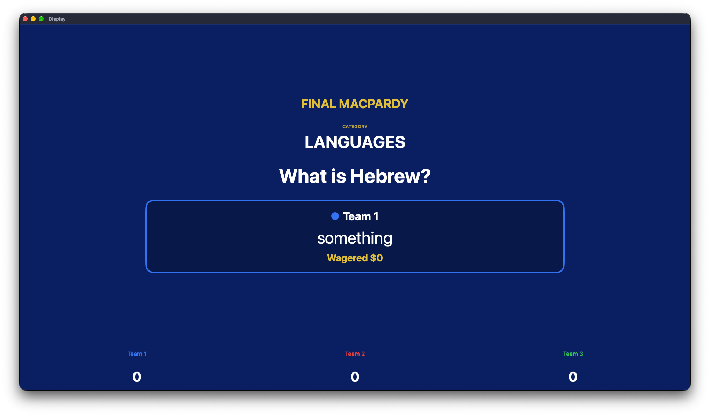
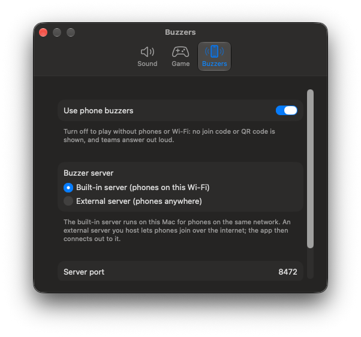

<div align="center">


# Macpardy

**Host a Jeopardy-style trivia night from your Mac. Teams buzz in from their phones.**

[](https://github.com/liljimmyk99/Macpardy/actions/workflows/ci.yml)
[](https://github.com/liljimmyk99/Macpardy/releases/latest)


[](LICENSE)

<!-- TODO screenshot: docs/images/hero-display.png (Display window showing the board) -->


</div>

Macpardy is a native macOS app for running a Jeopardy-style game ("Macpardy!") for a room of
people. You run the game from a **Control** window on your laptop, the room watches the
**Display** window on a TV or projector, and teams buzz in from their phones through a web page
the app serves on your network. No accounts, no backend, no internet needed.

## Contents

- [Features](#features)
- [How it works](#how-it-works)
- [Install](#install)
- [Quick start for developers](#quick-start-for-developers)
- [Keyboard shortcuts](#keyboard-shortcuts)
- [Documentation](#documentation)
- [Contributing](#contributing)
- [License](#license)

## Features

### Build or import a game

Make a 6 × 5 board for two rounds plus Final Macpardy in the built-in editor, with Daily
Doubles and optional pictures on clues. Or fill in a CSV template in any spreadsheet app and
import it. Open, edit and re-save games as `.macpardy` packages, `.json` or `.csv`.

<!-- TODO screenshot: docs/images/editor.png (board editor window) -->


### Run the show

Separate host and audience windows, a timer, scores, Daily Double and Final wagers. The Display
has animations for the board intro, clue flips, Daily Doubles and score changes (switchable in
Settings). Auto-save lets you resume after a quit or crash.

<!-- TODO screenshot: docs/images/control.png (Control window mid-game) -->


### Phone buzzers

Players scan a QR code, pick a team and buzz. Ties are broken fairly, there is a 5 s response
timer and a wrong-answer lockout. Final wagers and answers are typed on the phone and each
team's answer appears on the Display. Prefer no phones or Wi-Fi? Turn buzzers off in Settings.

<!-- TODO screenshot: docs/images/phone-buzzer.png (buzzer page on a phone) and docs/images/join-qr.png (join screen on the Display) -->
<p>
  
  
</p>

### Final Macpardy, settings and logs

Wager, answer and reveal in the final round. Settings cover sounds, timers, starting teams,
animations and buzzers. A Logs window shows why a phone dropped and exports logs for bug
reports.

<!-- TODO screenshot: docs/images/final-macpardy.png, docs/images/settings.png -->
<p>
  
  
</p>

Full walkthrough: [docs/features.md](docs/features.md).

## How it works

```
 Host's Mac                                             Players' phones
┌──────────────────────────────────────┐
│ Control window  ──►  GameState       │
│ Display window  ◄──  (one process)   │    Wi-Fi     ┌──────────────┐
│ Board editor                          │ ◄──────────► │ buzzer.html  │
│ Built-in buzzer server (port 8472) ───┼  WebSocket   │ (any browser)│
└──────────────────────────────────────┘              └──────────────┘
          optional: self-hosted buzzer server in Docker, for phones on other networks
```

Everything runs on the host's Mac in one process. The **built-in buzzer server** is the default
and serves phones on the same Wi-Fi. For players on other networks you can run the
[self-hosted buzzer server](docs/self-hosting.md). More detail:
[docs/architecture.md](docs/architecture.md).

## Install

Download `Macpardy.dmg` from the [latest release](https://github.com/liljimmyk99/Macpardy/releases/latest)
and drag the app to Applications. Builds are ad-hoc signed, not notarized, so macOS may warn
about an unidentified developer: Control-click the app, choose **Open**, then **Open** again
(see [EXPORTING.md](EXPORTING.md#sharing-limits)). Requires macOS 26.3 or later.

## Quick start for developers

Requires macOS with Xcode 26 and [Tuist](https://tuist.io) (CI pins 4.50.2).

```sh
tuist generate   # generates and opens Macpardy.xcodeproj
```

Run the **Macpardy** scheme. Run the tests from the command line:

```sh
xcodebuild test -project Macpardy.xcodeproj -scheme Macpardy -destination 'platform=macOS'
```

More in [docs/getting-started.md](docs/getting-started.md). To make a shareable build, see
[EXPORTING.md](EXPORTING.md).

## Keyboard shortcuts

| Shortcut | Action |
|---|---|
| ⌘O / ⌘N | File menu: **Import Board…** (play or edit), **New Board**; **Open Recent** lists the last 10 boards |
| ⌘S | Editor: **Save Game** |
| ⌘T | Start / pause the timer |
| ⌘R | **Reveal Answer** |
| ⌘, | **Settings** (sound, timers, starting teams, buzzers on/off and port) |
| ⌘/ | **Keyboard Shortcuts** window (also the keyboard button in the Control toolbar) |
| ⌥⌘L | **Logs** window: why phones dropped, with **Export Logs…** |
| ⌘D | **Show Display** |
| ⌘B | **Return to Board** (on a clue) |
| ⌘⇧B | **Buzzers** popover (when buzzers are on) |
| ⌘J | Show / hide the buzzer **join screen** on the Display (mid-game, when buzzers are on) |
| ⌘F | **Final Macpardy** (from the board) |
| ⌘→ | **Next Round** (from the board) |
| ← ↑ → ↓, Return | Board: highlight a clue (on both screens), then open it |
| ⌘← | Reset the timer |
| ⌘− / ⌘+ | Timer −5 s / +5 s |

Everything except the start screen, editor and board-arrow ones is in the **Game** menu, which
greys out items that don't apply. Where each one applies:
[docs/features.md §7](docs/features.md#7-keyboard-shortcuts).

## Documentation

| | |
|---|---|
| [docs/getting-started.md](docs/getting-started.md) | Build, run, test, and play a first game |
| [docs/how-to.md](docs/how-to.md) | Recipes: add a setting, a view, a string, a sound, a shortcut; change a file format; release |
| [docs/troubleshooting.md](docs/troubleshooting.md) | Phones can't connect, logs, common build problems |
| [docs/features.md](docs/features.md) | What the app does and how a game flows |
| [docs/architecture.md](docs/architecture.md) | State, windows, phases, persistence, buzzer subsystem |
| [docs/file-structure.md](docs/file-structure.md) | Where everything lives |
| [docs/board-format.md](docs/board-format.md) | Board file formats |
| [docs/csv-import.md](docs/csv-import.md) | Creating a game from CSV |
| [docs/sounds.md](docs/sounds.md) | Sound effects and music |
| [docs/buzzer-protocol.md](docs/buzzer-protocol.md) | Phone ⇄ app WebSocket protocol, and the host protocol |
| [docs/self-hosting.md](docs/self-hosting.md) | Running the buzzer server in Docker so phones on other networks can join |
| [EXPORTING.md](EXPORTING.md) | Building a `.app` / `.dmg` and cutting a release |
| [AGENTS.md](AGENTS.md) | Conventions for contributors and coding agents (read this first) |

## Contributing

Issues and pull requests are welcome. Read [CONTRIBUTING.md](CONTRIBUTING.md) and
[AGENTS.md](AGENTS.md) first.

## License

[MIT](LICENSE) © 2026 Jimmy Kane
